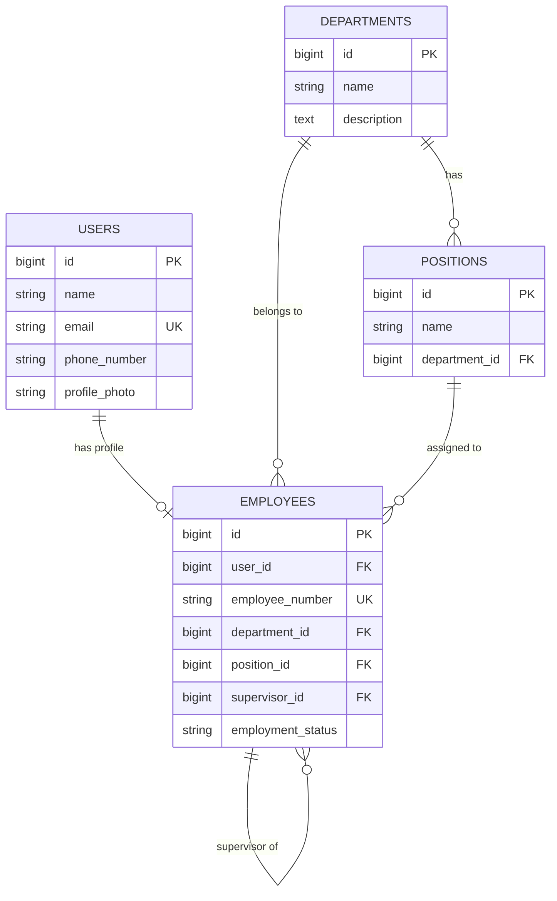
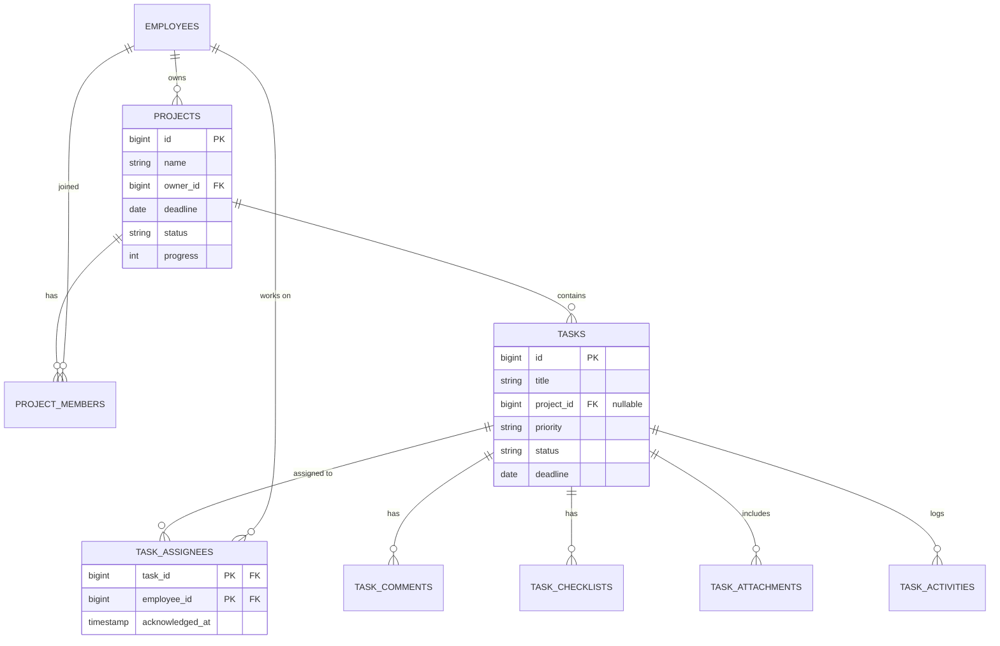
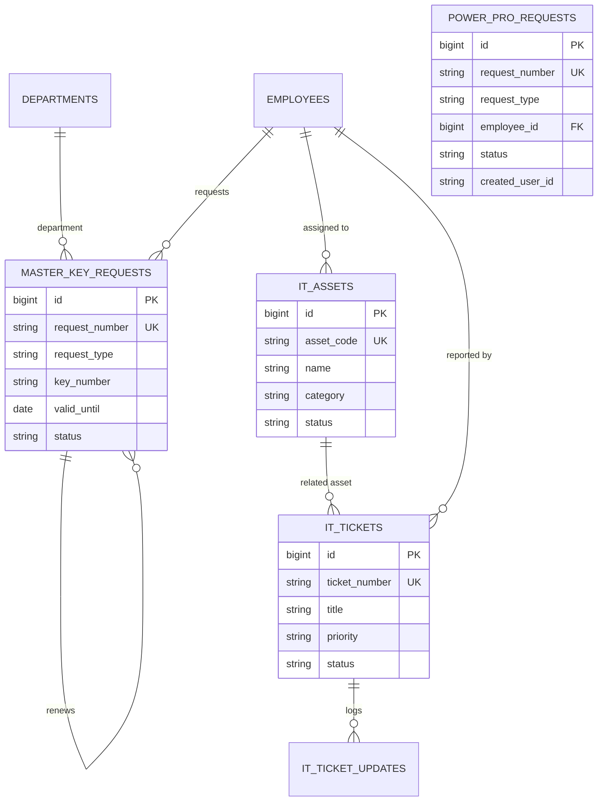

# Entity Relationship Diagram (ERD) - SIPU Management (Swiss-Belinn)

Dokumen ini memuat Entity Relationship Diagram (ERD) lengkap dari database sistem **SIPU Management (HRMS & Hotel Operations)**.

> **Cara Membuka Diagram:**
> 1. **Di IDE / VS Code:** Tekan `Ctrl + Shift + V` untuk membuka **Markdown Preview** di tab sebelah.
> 2. **Di Browser (Interaktif):** Buka file [public/erd.html](file:///d:/Perkuliahan/InternShip%20Swiss%20BellInn%20PKU/web/public/erd.html) langsung di browser (Chrome / Edge / Firefox) atau akses `http://localhost:8000/erd.html`.
> 3. **Di Database Tool (DBeaver / TablePlus / DB Browser for SQLite):** Buka file database lokal `database/database.sqlite`.

---

## 1. Diagram ERD Lengkap (Full ERD)

```mermaid
erDiagram
    %% Core & Employee
    USERS ||--o| EMPLOYEES : "has profile"
    DEPARTMENTS ||--o{ POSITIONS : "has"
    DEPARTMENTS ||--o{ EMPLOYEES : "belongs to"
    POSITIONS ||--o{ EMPLOYEES : "assigned to"
    EMPLOYEES ||--o{ EMPLOYEES : "supervisor of"

    %% Project & Task Management
    EMPLOYEES ||--o{ PROJECTS : "owns"
    DEPARTMENTS ||--o{ PROJECTS : "categorized by"
    USERS ||--o{ PROJECTS : "created by"
    PROJECTS ||--o{ PROJECT_MEMBERS : "has"
    EMPLOYEES ||--o{ PROJECT_MEMBERS : "joined as"

    PROJECTS ||--o{ TASKS : "contains"
    USERS ||--o{ TASKS : "created by"
    TASKS ||--o{ TASK_ASSIGNEES : "assigned to"
    EMPLOYEES ||--o{ TASK_ASSIGNEES : "works on"
    TASKS ||--o{ TASK_COMMENTS : "has"
    EMPLOYEES ||--o{ TASK_COMMENTS : "writes"
    TASKS ||--o{ TASK_ATTACHMENTS : "includes"
    EMPLOYEES ||--o{ TASK_ATTACHMENTS : "uploads"
    TASKS ||--o{ TASK_CHECKLISTS : "has"
    EMPLOYEES ||--o{ TASK_CHECKLISTS : "completed by"
    TASKS ||--o{ TASK_ACTIVITIES : "logs"
    EMPLOYEES ||--o{ TASK_ACTIVITIES : "triggered by"

    %% Schedule, Attendance & Requests
    SHIFTS ||--o{ WORK_SCHEDULES : "defines"
    EMPLOYEES ||--o{ WORK_SCHEDULES : "scheduled on"
    EMPLOYEES ||--o{ ATTENDANCES : "records"
    EMPLOYEES ||--o{ LEAVE_REQUESTS : "submits"
    USERS ||--o{ LEAVE_REQUESTS : "approved by"
    EMPLOYEES ||--o{ OVERTIME_REQUESTS : "submits"
    USERS ||--o{ OVERTIME_REQUESTS : "approved by"

    %% Performance Management
    PERFORMANCE_PERIODS ||--o{ SUPERVISOR_ASSESSMENTS : "evaluated in"
    EMPLOYEES ||--o{ SUPERVISOR_ASSESSMENTS : "evaluated"
    EMPLOYEES ||--o{ SUPERVISOR_ASSESSMENTS : "evaluated by"
    PERFORMANCE_PERIODS ||--o{ PERFORMANCE_SCORES : "calculated in"
    EMPLOYEES ||--o{ PERFORMANCE_SCORES : "receives"

    %% Payroll Management
    PAYROLL_PERIODS ||--o{ PAYROLLS : "generates"
    EMPLOYEES ||--o{ PAYROLLS : "receives"
    PAYROLLS ||--o{ PAYROLL_ITEMS : "contains"

    %% IT Operations & Master Key
    EMPLOYEES ||--o{ MASTER_KEY_REQUESTS : "requests"
    DEPARTMENTS ||--o{ MASTER_KEY_REQUESTS : "for department"
    USERS ||--o{ MASTER_KEY_REQUESTS : "done by user"
    MASTER_KEY_REQUESTS ||--o{ MASTER_KEY_REQUESTS : "renews/replaces"

    EMPLOYEES ||--o{ IT_ASSETS : "assigned to"
    EMPLOYEES ||--o{ IT_TICKETS : "reported by"
    USERS ||--o{ IT_TICKETS : "assigned to"
    IT_ASSETS ||--o{ IT_TICKETS : "related to"
    IT_TICKETS ||--o{ IT_TICKET_UPDATES : "logs"
    USERS ||--o{ IT_TICKET_UPDATES : "updated by"

    %% Power Pro Hotel System Access
    EMPLOYEES ||--o{ POWER_PRO_REQUESTS : "requests"
    DEPARTMENTS ||--o{ POWER_PRO_REQUESTS : "for department"
    USERS ||--o{ POWER_PRO_REQUESTS : "requested by"
    USERS ||--o{ POWER_PRO_REQUESTS : "approved by"
    USERS ||--o{ POWER_PRO_REQUESTS : "processed by"

    %% Documents & Audit
    USERS ||--o{ ANNOUNCEMENTS : "posts"
    DEPARTMENTS ||--o{ DOCUMENTS : "belongs to"
    USERS ||--o{ DOCUMENTS : "uploaded by"
    USERS ||--o{ AUDIT_LOGS : "performed by"

    USERS {
        bigint id PK
        string name
        string email UK
        string password
        string phone_number
        string profile_photo
    }

    EMPLOYEES {
        bigint id PK
        bigint user_id FK "nullable"
        string employee_number UK
        string phone_number
        bigint department_id FK
        bigint position_id FK
        bigint supervisor_id FK "self reference"
        date join_date
        string employment_status
        string account_status
        string profile_photo
    }

    DEPARTMENTS {
        bigint id PK
        string name
        text description
    }

    POSITIONS {
        bigint id PK
        string name
        bigint department_id FK
    }

    PROJECTS {
        bigint id PK
        string name
        text description
        bigint owner_id FK
        bigint department_id FK
        date start_date
        date deadline
        string status
        int progress
        bigint created_by FK
    }

    PROJECT_MEMBERS {
        bigint project_id PK "FK"
        bigint employee_id PK "FK"
    }

    TASKS {
        bigint id PK
        string title
        text description
        bigint project_id FK "nullable"
        bigint created_by FK
        string priority
        string status
        date start_date
        date deadline
        int estimated_duration
    }

    TASK_ASSIGNEES {
        bigint task_id PK "FK"
        bigint employee_id PK "FK"
        timestamp acknowledged_at
    }

    TASK_COMMENTS {
        bigint id PK
        bigint task_id FK
        bigint employee_id FK
        text content
        json tagged_user_ids
        string attachment_path
    }

    TASK_CHECKLISTS {
        bigint id PK
        bigint task_id FK
        string title
        boolean is_completed
        bigint completed_by FK
    }

    TASK_ATTACHMENTS {
        bigint id PK
        bigint task_id FK
        bigint employee_id FK
        string file_path
        string file_name
        int file_size
    }

    TASK_ACTIVITIES {
        bigint id PK
        bigint task_id FK
        bigint employee_id FK
        string action
        text description
        json old_value
        json new_value
    }

    SHIFTS {
        bigint id PK
        string name
        time start_time
        time end_time
        string color
    }

    WORK_SCHEDULES {
        bigint id PK
        bigint employee_id FK
        bigint shift_id FK
        date date
    }

    ATTENDANCES {
        bigint id PK
        bigint employee_id FK
        date date
        time clock_in
        time clock_out
        string status
        int late_duration_minutes
        int overtime_minutes
        string source
    }

    LEAVE_REQUESTS {
        bigint id PK
        bigint employee_id FK
        string type
        date start_date
        date end_date
        text reason
        string status
        bigint approved_by FK
    }

    OVERTIME_REQUESTS {
        bigint id PK
        bigint employee_id FK
        date date
        time start_time
        time end_time
        text reason
        string status
        bigint approved_by FK
    }

    PERFORMANCE_PERIODS {
        bigint id PK
        string name
        date start_date
        date end_date
        string type
    }

    SUPERVISOR_ASSESSMENTS {
        bigint id PK
        bigint employee_id FK
        bigint supervisor_id FK
        bigint performance_period_id FK
        int work_quality
        int accuracy
        int responsibility
        int communication
        text notes
    }

    PERFORMANCE_SCORES {
        bigint id PK
        bigint employee_id FK
        bigint performance_period_id FK
        decimal completion_rate
        decimal on_time_rate
        decimal task_weight_score
        decimal supervisor_score
        decimal final_epi
        string category
    }

    PAYROLL_PERIODS {
        bigint id PK
        string name
        int month
        int year
        date start_date
        date end_date
        string status
    }

    PAYROLLS {
        bigint id PK
        bigint employee_id FK
        bigint payroll_period_id FK
        decimal base_salary
        decimal total_allowance
        decimal total_deduction
        decimal net_salary
        string status
    }

    PAYROLL_ITEMS {
        bigint id PK
        bigint payroll_id FK
        string type
        string name
        decimal amount
    }

    MASTER_KEY_REQUESTS {
        bigint id PK
        string request_number UK
        string request_type
        string request_by
        bigint employee_id FK
        bigint department_id FK
        string key_number
        string room_range_access
        date valid_from
        date valid_until
        string status
        bigint requested_by_user_id FK
        bigint done_by_user_id FK
        text requester_signature
        text approver_signature
        bigint previous_request_id FK
    }

    POWER_PRO_REQUESTS {
        bigint id PK
        string request_number UK
        string request_type
        bigint employee_id FK
        bigint department_id FK
        string employment_status
        string system_type
        json power_pro_modules
        string access_level
        json special_privileges
        string proposed_username
        text reason
        string status
        bigint requested_by_user_id FK
        bigint approved_by_user_id FK
        bigint processed_by_user_id FK
        string created_user_id
        text it_notes
        text rejection_reason
        text requester_signature
        text approver_signature
        text it_signature
    }

    IT_ASSETS {
        bigint id PK
        string asset_code UK
        string name
        string category
        string brand
        string status
        bigint assigned_to_employee_id FK
        string location
        string ip_address
    }

    IT_TICKETS {
        bigint id PK
        string ticket_number UK
        string title
        text description
        string category
        string priority
        string status
        bigint reported_by_employee_id FK
        bigint assigned_to_user_id FK
        bigint it_asset_id FK
    }

    IT_TICKET_UPDATES {
        bigint id PK
        bigint it_ticket_id FK
        bigint user_id FK
        string status_from
        string status_to
        text message
    }

    DOCUMENTS {
        bigint id PK
        string title
        string file_path
        string type
        bigint department_id FK
        bigint uploaded_by FK
    }

    ANNOUNCEMENTS {
        bigint id PK
        string title
        text message
        string target_audience
        bigint created_by FK
        timestamp published_at
    }

    AUDIT_LOGS {
        bigint id PK
        bigint user_id FK
        string action
        string model_type
        bigint model_id
        text description
        json old_values
        json new_values
        string ip_address
    }
```

---

## 2. Diagram per Modul

### A. Modul Organisasi & Karyawan

### B. Modul Project & Task Management

### C. Modul Operasional IT & Master Key

